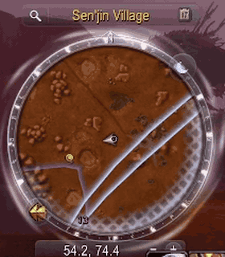
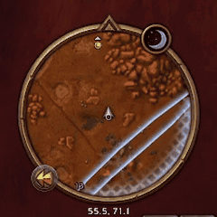

# NodeRadar

Gathering while you walk or ride across a zone usually means staring at the minimap. Look away
for a second to read a quest, pull a mob or answer guild chat, and that Peacebloom you wanted
slides right past the edge of the map.

NodeRadar keeps an eye on the minimap so you don't have to. Turn on Find Herbs or Find Minerals and
just play: the moment a herb or ore node shows up, you hear a ping and a sonar ripples out from it
on the map, green for herbs, gold for ore. Look up, go grab it, carry on.

Made for **World of Warcraft: Forever**.

## Install

Install **NodeRadar** from [CurseForge](https://www.curseforge.com/wow/addons/node-radar) or
[Wago](https://addons.wago.io/addons/noderadar), with their apps or by unzipping it into the
`Interface\AddOns` folder inside your Forever game folder. Then `/reload`, or start the game, and
turn on Find Herbs or Find Minerals.

## How it works

- **It reads the minimap's blips.** About every 4 yards you move (every 2 s standing still) it
  samples the minimap through the client's own mouseover (the same data its tooltip shows), so it
  sees what you'd see by hovering every blip. Each look takes about 4 ms. It works under any minimap
  skin, and your own hover tooltip isn't affected.
- **It learns which names are nodes.** The minimap also shows quests, group members and town
  NPCs. NodeRadar knows a node by its name, learned once and remembered for your whole account:
  - when you **gather** a node, it learns that node's name;
  - optionally (`/nr learn`, off by default): when it sees a name it doesn't know, and you're
    standing still out of combat, it turns your gathering tracking off for a moment and back on, and
    sees what disappeared, since a herb is what vanishes when Find Herbs is off. Turning tracking
    back on costs a global cooldown, which is why it's off by default. If anything stops it from
    turning tracking back on, it says so in chat.
- **It ships knowing every classic herb and ore node**, Peacebloom to Black Lotus, Copper Vein to
  Rich Thorium Vein, by name in English, German, French, Spanish, Portuguese, Italian, Russian,
  Korean and Chinese, so it alerts from the start. A name it doesn't know yet it learns as you
  gather.
- **It alerts only for nodes you can gather.** It knows what each classic node needs (Mageroyal,
  Herbalism 50) and reads your skill with its bonuses, so a Mithril Deposit doesn't ping a miner at
  90. A Tauren herbalist still hears herbs above their skill while Cultivation is ready, since it
  grows a copy anyone can gather. A node whose requirement it doesn't know, or a skill it can't read,
  alerts as usual. `/nr skill` turns this off.
- **Optionally, each node shows its item's icon** on the minimap (Peacebloom, Copper Ore) instead
  of Blizzard's yellow dot, dimmed when your skill can't gather it yet (`/nr icons`, off by
  default). NodeRadar measures where each new node is once and keeps it in place
  as you move; near the map's edge, and where nodes of one name crowd together, the dot shows.
  Each icon sits in a frame that follows your minimap: a glass disc with Glass MiniMap, a bronze
  ring like Blizzard's minimap buttons otherwise (or none, or the one you pick), small, medium or
  large, with a small arrow when the node is above or below you.
- **Experimental: a compass toward the nearest node** (`/nr compass`, off by default). A small ring
  under your character points toward the nearest node you can gather, with the distance, so you can
  ride from node to node without watching the minimap; it moves on as you gather. It points only at
  nodes NodeRadar has measured (where nodes of one name crowd together, it may miss some), and hides
  within 15 yards (for a glow on the node itself, Lueur does that well). It follows your
  character's facing, not the camera's: turning the camera alone doesn't turn it.

**Limits:** names are what it goes by. A quest or NPC with exactly a node's name would be taken for
one. A node leaving the map's edge in the same half second another of its name comes in may not
alert.

## Options

**Esc > Options > AddOns > NodeRadar** (or `/nr options`): the radar on or off; how often it looks,
standing still (1, 2 or 5 s) and moving (about every 2, 4 or 8 yards: more often costs more memory
for the game to clean up); the sound, from a dropdown (the minimap ping, a sonar or radar ping from
the game, or one of six shipped with NodeRadar: sonar, radar blip, deep-sea sonar, bell chime,
notification, sci-fi HUD ping), the sonar on the node, a chat line (each node with its approximate
map coordinates, `Peacebloom (45.2, 61.8)`: every node of an alerted name, since which one is new
can't be told), Blizzard's ping, the time
between alerts, a test button; only nodes you can gather; Blizzard's dots or item icons on the
minimap, the icon's frame and size; the experimental compass; learning by toggling tracking.

## Commands

- `/nr`: radar on or off; `/nr options`: the Options page
- `/nr sound`, `/nr ring`, `/nr chat`: the sound, the sonar on the node, a chat line;
  `/nr sound <name>`: which sound (`/nr help` lists the names)
- `/nr ping`: Blizzard's minimap ping on the node too, solo only (in a group it would show on
  everyone's minimap)
- `/nr skill`: alert only for nodes your skill can gather (on by default)
- `/nr icons`: each node's item icon on the minimap instead of Blizzard's dot (off by default)
- `/nr iconstyle auto | plain | glass | bronze`: the icon's frame (auto: glass with Glass MiniMap,
  else bronze); `/nr iconsize small | medium | large`
- `/nr compass`: the experimental compass toward the nearest node (off by default)
- `/nr learn`: learning by turning tracking off and on (off by default: it costs a global cooldown)
- `/nr cd <1-60>`: seconds between alerts
- `/nr test`, `/nr status`, `/nr known`, `/nr forget <name>`, `/nr failures`, `/nr reset`

## License

MIT, except the six alert sounds below.

## Sounds

The six sounds in `Media/*.ogg` are royalty-free sound effects from [Pixabay](https://pixabay.com),
under the [Pixabay Content License](https://pixabay.com/service/terms/), not MIT:

| File | Pixabay | By |
|---|---|---|
| `Sonar.ogg` | "sonar ping", #95840 | freesound_community |
| `RadarBlip.ogg` | "radar ping", #306440 | user 49053354 |
| `DeepSea.ogg` | "deepsea sonar", #386156 | Dragon Studio |
| `BellChime.ogg` | "clear bell chime", #487898 | Universfield |
| `Notification.ogg` | "new notification 016", #350210 | Universfield |
| `HudPing.ogg` | "sci-fi HUD notification ping", #547867 | vadim_makes_sound |

Trimmed, made mono and evened in loudness by `Tools/import_sounds.py`. They ship inside NodeRadar
only, never as files of their own. The `LICENSE` that ships with the addon says the same.
