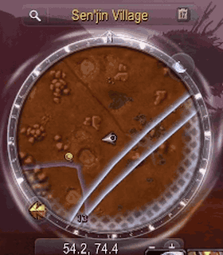
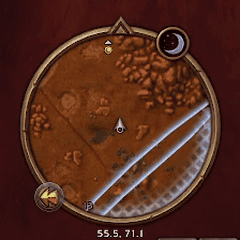
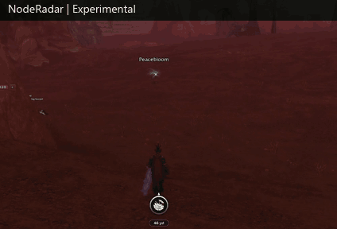

# NodeRadar

Gathering while you walk or ride across a zone usually means staring at the minimap. Look away
for a second to read a quest, pull a mob or answer guild chat, and that Peacebloom you wanted
slides right past the edge of the map.

NodeRadar keeps an eye on the minimap so you don't have to. Turn on Find Herbs or Find Minerals and
just play: the moment a herb or ore node shows up, you hear a ping and a sonar ripples out from it
on the map, green for herbs, gold for ore. Look up, go grab it, carry on.

Made for **World of Warcraft: Forever**.

> [!CAUTION]
> **Client build 70862 broke how NodeRadar sees nodes.** Blizzard changed the game, on
> purpose, so that addons can no longer read the minimap's dots from afar, and the radar went blind.
> Version 1.8.0 brings a workaround, the **minimap scan** (off by default: `/nr scan`, the Options
> page, or the question asked once at login). It finds nodes again, but it can't look while you steer
> with the mouse: **autorun, or moving and turning with the keyboard, gives much better results.** We're still working on it; see
> [The minimap scan](#the-minimap-scan-client-build-70862-and-later) below.

## Install

Install **NodeRadar** from [CurseForge](https://www.curseforge.com/wow/addons/node-radar) or
[Wago](https://addons.wago.io/addons/noderadar), with their apps or by unzipping it into the
`Interface\AddOns` folder inside your Forever game folder. Then `/reload`, or start the game, and
turn on Find Herbs or Find Minerals.

## The minimap scan (client build 70862 and later)

From client build 70862, Blizzard no longer lets addons read the minimap's dots from afar, on
purpose. On these builds NodeRadar finds nodes only with the **minimap scan** on: `/nr scan`, the
Options page, or the question it asks once at login.

- **How it looks.** While your mouse rests over the world, NodeRadar moves your minimap, invisible,
  under the cursor for a few frames and reads what lies there. It does this every 2 s while you move
  and every 6 s standing still (`/nr scan <1-10>` sets the moving interval). A new herb or ore sounds
  and gets its chat line as soon as a look sees it.
- **Where it is.** NodeRadar then narrows the node down with a few more quick looks, usually within
  a second or two, for its icon, the sonar on it, the compass and the beacon.
- **Your minimap's own ground stands in for it.** The minimap leaves its corner for a split second at
  each look, more often for a moment while a new node is being located. Meanwhile NodeRadar draws
  the minimap's own ground and your arrow at its place, under its frame, so a look barely shows:
  outdoors in Eastern Kingdoms and Kalimdor, on the default minimap or a skin that says its shape
  (square ones too). Indoors, with a rotating minimap and elsewhere, a radar face with a turning
  sweep stands in instead. With Glass MiniMap, its own face does this from its version 1.2.0.
  Rarely the minimap's ground has stayed blank after a look until you move; we're looking into it.
- **When it can't look:**
  - in combat;
  - while a mouse button is held, so not while you steer with the mouse;
  - while you aim a spell, hold something on the cursor, cast, or have a loot window open;
  - while you hover a creature or a player, or rest the mouse on a button around the minimap;
  - while a tooltip or menu is open, or the cursor is over a window rather than the world.
- **Options says why it isn't running**, in red under its checkbox, with what to do on hover.
- **A look right after a fight, a flight and dismounting**, rather than at the next turn.
- **After steering with the mouse, it waits until you move the mouse again.** Autorun, or moving and
  turning with the keyboard, works best.
- **In the background it's slower.** The game runs a window without focus at its background frame
  rate (30 by default, `maxFPSBk`), and a look then fits less work, so locating takes much longer.
- **Positions are approximate.** The icons, the compass and the distant beacon can be a few yards off
  the node, up to about ten. With the experimental marker on, its nearby stars show the node's exact
  spot within about 15 yards.
- **After a reload, located nodes are found again.** That takes a few seconds; until then the
  minimap shows Blizzard's dots.
- **Your minimap's quest areas are switched off for each look** and back on right after: they'd
  otherwise flash across your screen. That's the only tracking the scan touches.
- **Other minimap addons.** With Glass MiniMap, the scan needs version 1.1.0 or later. If another
  addon's frame is anchored to your minimap, the scan doesn't run and NodeRadar names the addon once.
  If another addon's minimap scan is on, or something keeps moving your minimap, NodeRadar's scan
  waits: two of them break each other's minimap.

## How it works

- **Before build 70862, it reads the minimap's blips.** About every 4 yards you move (every 2 s standing still) it
  samples the minimap through the client's own mouseover (the same data its tooltip shows), so it
  sees what you'd see by hovering every blip. Each look takes about 4 ms. It works under any minimap
  skin, and your own hover tooltip isn't affected.
- **It learns which names are nodes.** The minimap also shows quests, group members and town
  NPCs. NodeRadar knows a node by its name, learned once and remembered for your whole account:
  - when you **gather** a node, it learns that node's name;
  - optionally (`/nr learn`, off by default): when it sees a name it doesn't know, and you're
    standing still out of combat, it turns your gathering tracking off for a moment and back on, and
    sees what disappeared, since a herb is what vanishes when Find Herbs is off. Turning tracking
    back on costs a global cooldown, which is why it's off by default. If anything stops it from
    turning tracking back on, it says so in chat.
- **It ships knowing every classic herb and ore node**, Peacebloom to Black Lotus, Copper Vein to
  Rich Thorium Vein, by name in English, German, French, Spanish, Portuguese, Italian, Russian,
  Korean and Chinese, so it alerts from the start. A name it doesn't know yet it learns as you
  gather.
- **It alerts only for nodes you can gather.** It knows what each classic node needs (Mageroyal,
  Herbalism 50) and reads your skill with its bonuses, so a Mithril Deposit doesn't ping a miner at
  90. A Tauren herbalist still hears herbs above their skill while Cultivation is ready, since it
  grows a copy anyone can gather. A node whose requirement it doesn't know, or a skill it can't read,
  alerts as usual. `/nr skill` turns this off.
- **You choose which herbs and ores.** NodeRadar's Herbs and Ores pages (under it in the AddOns
  list) have one checkbox per herb or ore, with each node and the skill it needs, plus All, None,
  All I can gather and Skill-ups only. A node you skip makes no alert, no chat line, and is never
  the compass's target; on the minimap its icon is dimmed (or Blizzard's dot, your choice). Smart,
  on by default, keeps the list to what gives skill-ups as you level: it checks a node when your
  skill reaches it and unchecks it when it turns grey. The choices are per character.
- **The skill each node needs, in the minimap's tooltip**: hover a herb or ore on the minimap and
  under its name reads "Requires Herbalism (15)", coloured as the node's own tooltip in the world:
  red while it's beyond you, then orange, yellow, green and grey as it gets easier (`/nr tooltip`,
  on by default).
- **Optionally, each node shows its item's icon** on the minimap (Peacebloom, Copper Ore) instead
  of Blizzard's yellow dot, dimmed when your skill can't gather it yet (`/nr icons`, off by
  default). NodeRadar measures where each new node is once and keeps it in place
  as you move, two of a name side by side included. A node it hasn't measured yet gets an icon
  near its dot until it is. The dot still shows near the map's edge, and where three or more of a
  name crowd together, or two almost on top of each other. Other dots (treasure, quests, party)
  stay Blizzard's.
  Each icon sits in a frame that follows your minimap: a glass disc with Glass MiniMap, a bronze
  ring like Blizzard's minimap buttons otherwise (or none, a yellow ring the colour of the
  minimap's tracking dots, or the one you pick), small, medium or large, with a small arrow when the node is above or below you.
- **Experimental: a compass toward the nearest node** (`/nr compass`, off by default). Under your
  character, the nearest node you can gather shows as its item's icon on a small dark lens with a
  thin rim that follows the minimap icons' frame (pearl with Glass MiniMap, bronze otherwise, or yellow), with
  an arrow circling it toward the node and the distance below; hover it for the item's tooltip (clicks go through it). Small,
  medium or large (`/nr compasssize`). It moves on as you gather, points only at nodes NodeRadar has
  measured (where nodes of one name crowd together, it may miss some), and hides within 15 yards
  (the optional nearby marker covers the node itself). It follows your character's facing, not the
  camera's: turning the camera alone doesn't turn it. Hold Alt and drag it to move it (lock it in
  Options, `/nr compass reset` puts it back). A node out of reach (on a ledge, among mobs too
  strong)? Snooze it, and the compass moves on: from NodeRadar's minimap button, for 15 minutes,
  30 minutes, an hour or the session, or with a key binding. A reload clears them.
- **Experimental: a marker in the world** (`/nr marker`, off by default). Independently twinkling,
  drifting stars in soft teal vapor name the nearest wanted herb or ore within 60 yards, with an above/below hint.
  They shrink with distance and fade out between 45 and 60 yards; the compass supplies the
  distance readout. Their height is approximate, and they can show through terrain. Nearby, when the game supplies
  the node's interact plate (about 15 yards), twinkling stars take over at the node's real spot.
  The beacon works with the compass off. Your own map pin or tracked objective takes priority
  (an addon that tracks quests for you, such as a levelling guide, keeps the distant beacon hidden;
  the nearby stars still show); while the beacon is active, a newly accepted quest may not
  automatically become tracked.
  Interact targeting and in-game navigation settings are restored when no longer needed, and
  changes of yours are kept. Distance scaling and the vapor-and-sparkle appearance have been checked in game.

  

- **Your group's nodes on your minimap** (`/nr share` on the gatherer, `/nr party` on the other;
  both off by default). Two characters together, say a herbalist following your main: the gatherer
  sends the nodes it finds to the group, and the other draws them as item icons with a small blue dot,
  without the profession or any tracking there, whether its own icons are on or not. Only nodes the
  gatherer wants are sent (its skill, its herb and ore lists); a node it gathers leaves the other
  minimap at once, and leaving the group clears them. Both need NodeRadar, and the two characters in
  one party or raid. The compass, and the marker's distant beacon that follows it, point at the
  group's nodes too, your own first: the group's only when you have none of yours to point at (so a
  miner and an herbalist each keep their own). The marker's nearby stars show on any group node
  within reach, yours or not. A group member's node that arrives ripples on your minimap as your
  own do (the sonar on the node), best effort.

- **A minimap button.** Left-click: quick settings (the radar, the icons, the compass) and the
  compass's snooze; right-click: the Options page. It drags around the minimap, and button
  collectors take it. Also in the AddOns compartment.

**Limits:** names are what it goes by. A quest or NPC with exactly a node's name would be taken for
one. A node leaving the map's edge in the same half second another of its name comes in may not
alert.

## Options

**Esc > Options > AddOns > NodeRadar** (or `/nr options`): the radar on or off; the minimap scan,
how often it looks while you move and, in red, why it isn't running (build 70862 and later); how often the radar looks,
standing still (1, 2 or 5 s) and moving (about every 2, 4 or 8 yards: more often costs more memory
for the game to clean up); the sound, from a dropdown (the minimap ping, a sonar or radar ping from
the game, or one of six shipped with NodeRadar: sonar, radar blip, deep-sea sonar, bell chime,
notification, sci-fi HUD ping), the sonar on the node, a chat line (each node with its approximate
map coordinates, `Peacebloom (45.2, 61.8)`: every node of an alerted name, since which one is new
can't be told), Blizzard's ping, the time
between alerts, a test button; only nodes you can gather; Blizzard's dots or item icons on the
minimap, the icon's frame and size, what a skipped node shows; the experimental compass and marker; your
group's nodes (sending yours, showing theirs); learning by
toggling tracking. Under it, **Herbs** and **Ores**: which to follow, the presets and smart.

## Commands

- `/nr`: radar on or off; `/nr options`: the Options page
- `/nr sound`, `/nr ring`, `/nr chat`: the sound, the sonar on the node, a chat line;
  `/nr sound <name>`: which sound (`/nr help` lists the names)
- `/nr ping`: Blizzard's minimap ping on the node too, solo only (in a group it would show on
  everyone's minimap)
- `/nr skill`: alert only for nodes your skill can gather (on by default)
- `/nr ignore <node or item>`, `/nr track <node or item>`: skip or follow a herb or ore, by a node's
  name, the item's, or its item ID; `/nr ignore` lists the skipped; `/nr smart`: the list follows
  your skill (on by default)
- `/nr icons`: each node's item icon on the minimap instead of Blizzard's dot (off by default)
- `/nr tooltip`: the skill a node needs in the minimap's tooltip, coloured (on by default)
- `/nr iconstyle auto | plain | glass | bronze | yellow`: the icon's frame (auto: glass with Glass MiniMap,
  else bronze); `/nr iconsize small | medium | large`
- `/nr compass`: the experimental compass toward the nearest node (off by default);
  `/nr compasssize small | medium | large`; `/nr compass lock | unlock | reset`: its position (Alt-drag
  moves it)
- `/nr marker`: the experimental distant beacon and nearby stars (off by default)
- `/nr share`: send the nodes you find to your group; `/nr party`: show your group's nodes on your
  minimap (both off by default)
- `/nr snooze [15 | 30 | 60 | session]`: snooze the compass's node (the key binding's length, in
  Key Bindings > NodeRadar); `/nr snooze clear`
- `/nr learn`: learning by turning tracking off and on (off by default: it costs a global cooldown)
- `/nr scan`: the minimap scan, client build 70862 and later (off by default); `/nr scan <1-10>`:
  seconds between its looks while you move (three times that standing still, at most 10)
- `/nr cd <1-60>`: seconds between alerts
- `/nr test`, `/nr status`, `/nr known`, `/nr forget <name>`, `/nr failures`, `/nr reset`

## Thanks

- **ThPi** ([ThorbenP](https://github.com/ThorbenP) on GitHub), for the idea behind the minimap scan
  mode (#91). When client build 70862 stopped addons from reading the minimap's dots from afar,
  they shared the way back in a comment on [NodeRadar's CurseForge page](https://www.curseforge.com/wow/addons/node-radar): move the minimap itself
  under the resting mouse for an instant and read what lies there.

## License

MIT, except the six alert sounds below.

## Sounds

The six sounds in `Media/*.ogg` are royalty-free sound effects from [Pixabay](https://pixabay.com),
under the [Pixabay Content License](https://pixabay.com/service/terms/), not MIT:

| File | Pixabay | By |
|---|---|---|
| `Sonar.ogg` | "sonar ping", #95840 | freesound_community |
| `RadarBlip.ogg` | "radar ping", #306440 | user 49053354 |
| `DeepSea.ogg` | "deepsea sonar", #386156 | Dragon Studio |
| `BellChime.ogg` | "clear bell chime", #487898 | Universfield |
| `Notification.ogg` | "new notification 016", #350210 | Universfield |
| `HudPing.ogg` | "sci-fi HUD notification ping", #547867 | vadim_makes_sound |

Trimmed, made mono and evened in loudness by `Tools/import_sounds.py`. They ship inside NodeRadar
only, never as files of their own. The `LICENSE` that ships with the addon says the same.
